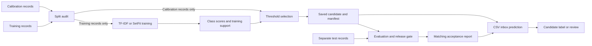

# Architecture and Python stack

## Data flow

## Stack

| Component | Choice | Purpose |
| --- | --- | --- |
| Runtime | Python 3.11 or later | API and CLI |
| Numeric operations | NumPy and SciPy | Class scores, similarity, and intervals |
| Default learner | scikit-learn | TF-IDF and logistic regression |
| Optional learner | SetFit and Sentence Transformers | Contrastive encoder fine-tuning and classifier training |
| Neural runtime | PyTorch | Local training and inference |
| Data interchange | JSONL and CSV | Labeled splits and inbox records |
| Artifacts | JSON, safetensors, and SHA-256 manifests | Explicit model state and integrity evidence |
| Package | Hatchling | Wheel and source archive |
| Tests | pytest and Hypothesis | Workflow, parity, property, and error tests |
| Analysis | Ruff and mypy | Source and type analysis |
| CI | GitHub Actions | Supported Python versions and distribution tests |

## Training backends

TF-IDF uses word unigrams and bigrams with a logistic regression head.
The export contains the vocabulary, inverse document frequencies, coefficients, intercept, and class prototypes.
It loads no pickle file.

SetFit fine-tunes the fixed `sentence-transformers/all-MiniLM-L6-v2` checkpoint.
The revision is `1110a243fdf4706b3f48f1d95db1a4f5529b4d41`.
Training uses SetFit's contrastive path and logistic head.

The export preserves the trained encoder and explicit numeric head.
Inference loads the encoder locally on the CPU.
The benchmark records the training device, step count, loss history, and encoder hashes before and after training.

## Acceptance policy

The candidate produces a proposed label and its class score.
It also computes cosine similarity with the training prototype for that label.

Threshold selection searches a fixed grid on calibration data.
It selects the feasible pair with the greatest accepted known count.
The configured empirical accuracy and unknown acceptance limits constrain that selection.

A request needs both thresholds and positive training support.
A SetFit request that exceeds the encoder token limit goes to review.
No feasible calibration policy means every request goes to review.

## Artifact and report binding

The model directory contains `model.json`, `manifest.json`, and an optional `encoder` directory.
The manifest hashes every model file.
The evaluation report records the manifest identity and test digest.

Model load examines the file hashes.
An optional release report must match the artifact and pass its recorded criteria.
Reports and labels remain trusted local inputs. A hash does not certify the labels or prevent a deliberately forged report.

## Resource and network boundaries

The default path makes no network request.
SetFit needs explicit permission for the initial checkpoint download.
The benchmark needs a separate explicit source download.

The core package has no provider SDK, hosted dashboard, HTTP server, or automatic fallback call.
The application decides how to handle a `review` result.
